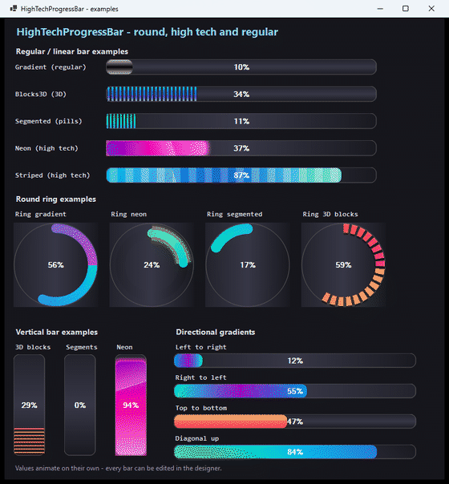

# TextProgressbar



A custom WinForms `ProgressBar` control — now named **`HighTechProgressBar`** — with gradient rendering, border styling, text display, multiple render styles, and circular ring mode.

## Shapes

Set `Shape` to choose the geometry:

- `ProgressShape.Linear` — bar (default)
- `ProgressShape.Circular` — radial ring / donut indicator with `RingThickness`, `StartAngle`, `Clockwise`, and `RoundCaps`

Set `Orientation` to `Orientation.Vertical` for bottom-up vertical bars — blocks stack vertically, stripes become horizontal bands, and the shimmer sweeps upward.

In circular mode the track ring is always drawn; the progress sweep supports all `RenderStyle` values, including segmented ring blocks, neon glow, and a rotating shimmer wedge.

## Render styles

Set the `RenderStyle` property to choose how the progress fill is drawn:

| Style | Description |
|---|---|
| `Gradient` | Smooth three-color gradient fill |
| `Blocks3D` | Discrete blocks with a beveled 3D edge (`BlockDepth`, `BlockGap`, `BlockCount`) |
| `Segmented` | Rounded pill-style blocks (`BlockCornerRadius`) |
| `Neon` | Gradient fill with an outer glow (`GlowColor`, `GlowSpread`) |
| `Striped` | Scrolling stripes / dashes (pairs with shimmer) |

## Effects

- `CornerRadius` — rounds the bar, progress fill, and border (linear mode).
- `ShimmerEnabled` / `ShimmerSpeed` / `ShimmerColor` / `ShimmerDirection` — animated light sweep (linear) or rotating highlight wedge (circular), on a `Timer` that only runs while the control is visible.
- `BlockGradientMode` — per-block gradient direction (`Vertical`, `Horizontal`, `Diagonal`).

## Sample app

`TextProgressbar.Samples` is a WinForms demo showing every linear and circular style with live sliders and global effect controls:

```
dotnet run --project TextProgressbar.Samples
```

## Credit

This project is based on / forked from [taancer/aProgressBar](https://github.com/taancer/aProgressBar) — *C# ProgressBar with Text*.
